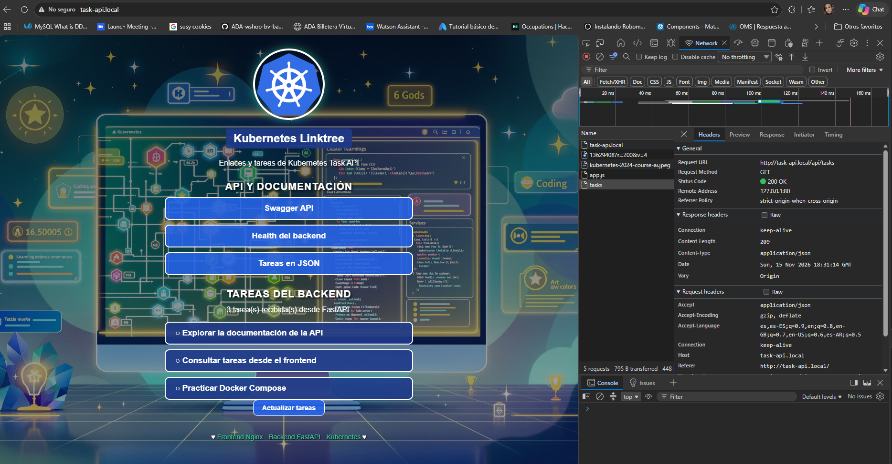
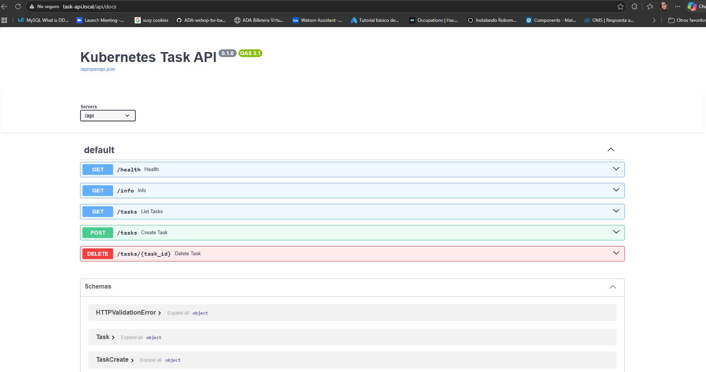

# Kubernetes Task API

A small FastAPI task API for learning Kubernetes locally. The current version stores tasks in each process's memory. It provides a three-replica Deployment so you can observe Kubernetes replacing a deleted Pod.

## Final result

After starting the frontend and backend with Kubernetes and Ingress, the
frontend displays the preloaded tasks and queries the backend through
`GET /api/tasks`:



### Swagger and OpenAPI

The backend interactive documentation is available through Ingress at
`http://task-api.local/api/docs`. The API uses OpenAPI 3.1 and exposes health,
Pod information, and task-management endpoints:

```text
GET    /api/health
GET    /api/info
GET    /api/tasks
POST   /api/tasks
DELETE /api/tasks/{task_id}
```



## Run locally

Requires Python 3.12 or a compatible Python 3 version.

```powershell
python -m venv .venv
.\.venv\Scripts\Activate.ps1
python -m pip install -r requirements-dev.txt
python -m uvicorn app.main:app --reload
```

Open `http://localhost:8000/docs` to try `GET /health`, `GET /info`, `GET /tasks`, `POST /tasks`, and `DELETE /tasks/{task_id}`. `/health` returns only the service status; `/info` exposes the current Pod hostname for Kubernetes exercises. Run tests with `python -m pytest -q`.

## Docker

```powershell
docker build -t kubernetes-task-api:local .
docker run --rm -p 8000:8000 kubernetes-task-api:local
```

Open `http://localhost:8000/docs`. Stop the container with Ctrl+C.

## Docker Compose multi-tier

The Compose setup runs the FastAPI backend and a static Nginx frontend:

```powershell
docker compose up --build
```

Open the Linktree-style frontend at `http://localhost:8080`. It queries the
backend through `/api/tasks` and displays the default tasks. The
API documentation remains available at `http://localhost:8000/docs`.

Stop the services with:

```powershell
docker compose down
```

## Remove the environment

### Why cleanup matters

Each `Deployment` creates Pods, and each Pod consumes cluster resources such as
CPU, memory, temporary storage, and network addresses. Leaving test
Deployments or old variants active can cause these problems:

- Unnecessary CPU and memory consumption.
- More Pods than expected, making the real state harder to understand.
- Requests distributed across the wrong versions or configurations.
- Duplicate Services that make endpoints harder to identify.
- Port, route, or name conflicts.
- Misleading results when testing replicas, load balancing, and self-healing.
- Higher resource usage and cost in a cloud cluster.

This project should keep only the resources from the current workflow:

```text
task-api Deployment        -> backend
task-api Service           -> internal backend access
task-frontend Deployment   -> frontend
task-frontend Service      -> internal frontend access
task-api-ingress and       -> HTTP entry point for the backend and frontend
task-frontend-ingress
```

Old Deployments such as `task-api-nodeport`,
`task-api-loadbalancer-v2`, and `task-api-clusterip-v2` are practice variants.
Remove them from the cluster when they are no longer being used. Pods created
by a Deployment are removed when the Deployment is deleted, so they do not
need to be deleted one by one.

At the end of a practice session, first remove the application resources:

```powershell
kubectl delete -f k8s/frontend/ --ignore-not-found
kubectl delete -f k8s/ingress.yaml --ignore-not-found
kubectl delete -f k8s/service.yaml --ignore-not-found
kubectl delete -f k8s/deployment.yaml --ignore-not-found
kubectl delete -f k8s/auth-config.yaml --ignore-not-found
kubectl delete secret auth-secret --ignore-not-found
```

Direct version, when you know all resources exist:

```powershell
kubectl delete -f k8s/frontend/
kubectl delete -f k8s/ingress.yaml
kubectl delete -f k8s/service.yaml
kubectl delete -f k8s/deployment.yaml
kubectl delete -f k8s/auth-config.yaml
minikube stop
```

If you also used Docker Compose, stop it as well:

```powershell
docker compose down
```

To keep the Minikube cluster but release its resources:

```powershell
minikube stop
```

To completely remove the cluster and its local Minikube images:

```powershell
minikube delete
```

Use `minikube delete` only when you want to start from scratch. It is not
needed after every practice session.

## Kubernetes with Minikube

Kubernetes replaces the Compose runtime and manages Pods, replicas, Services,
healthchecks, and Ingress. Docker, Minikube, and `kubectl` are required.

### 1. Iniciar Minikube

If Compose is running, stop it first to release the ports:

```powershell
docker compose down
minikube start --driver=docker
minikube status
kubectl get nodes
```

### 2. Enable Ingress

```powershell
minikube addons enable ingress
kubectl get pods -n ingress-nginx
```

### 3. Build the images

```powershell
docker build -t kubernetes-task-api:local .
docker build -t kubernetes-task-frontend:local ./frontend
```

### 4. Load the images into Minikube

The manifests use `imagePullPolicy: Never`, so the images must exist inside
the Minikube environment:

```powershell
minikube image load kubernetes-task-api:local
minikube image load kubernetes-task-frontend:local
```

### Reload an image after changing the code

When you change the backend or frontend, rebuild the image and load it into
Minikube again. Then restart the corresponding Deployment:

Backend:

```powershell
docker build -t kubernetes-task-api:local .
minikube image load kubernetes-task-api:local
kubectl rollout restart deployment/task-api
kubectl rollout status deployment/task-api
```

Frontend:

```powershell
docker build -t kubernetes-task-frontend:local ./frontend
minikube image load kubernetes-task-frontend:local
kubectl rollout restart deployment/task-frontend
kubectl rollout status deployment/task-frontend
```

Verify the Pods after the update:

```powershell
kubectl get pods
```

This is required because `imagePullPolicy: Never` uses the local Minikube
image and does not automatically download a new version from Docker.

### 5. Create the Secret required by the backend

Check whether it already exists:

```powershell
kubectl get secret auth-secret
```

If it does not exist, create it for the local environment:

```powershell
kubectl create secret generic auth-secret `
  --from-literal=AUTH_TOKEN=local-dev-token
```

### 6. Apply the manifests

Apply only the main manifests. The `ClusterIP`, `NodePort`, and `LoadBalancer`
practice variants are grouped under `k8s/practice/` and should not be applied
with the main backend.

```powershell
kubectl apply -f k8s/auth-config.yaml
kubectl apply -f k8s/deployment.yaml
kubectl apply -f k8s/service.yaml
kubectl apply -f k8s/frontend/
kubectl apply -f k8s/ingress.yaml
```

### 7. Verify the resources

```powershell
kubectl get deployments
kubectl get pods
kubectl get services
kubectl get ingress
kubectl rollout status deployment/task-api
kubectl rollout status deployment/task-frontend
```

Wait for 3 ready replicas for `task-api` and 2 for `task-frontend`.

### 8. Test each Service with Minikube

These commands temporarily expose each Service separately and return a local
URL:

```powershell
minikube service task-api --url
minikube service task-frontend --url
```

Test the backend with the resulting URL:

```text
<URL_BACKEND>/health
<URL_BACKEND>/docs
<URL_BACKEND>/tasks
```

`minikube service task-frontend --url` checks that the frontend is alive. To
let the frontend query the backend through `/api/tasks`, use the Ingress in the
next section.

### 9. Test the frontend and backend together through Ingress

In another terminal, run and leave this command active:

```powershell
minikube tunnel
```

As administrator, add this line to
`C:\Windows\System32\drivers\etc\hosts`:

```text
127.0.0.1 task-api.local
```

The application is available at:

```text
http://task-api.local/
http://task-api.local/api/tasks
http://task-api.local/api/docs
http://task-api.local/api/health
```

The backend receives `ROOT_PATH=/api` through the ConfigMap when running behind
Ingress. This makes Swagger UI look for the schema at `/api/openapi.json`
instead of requesting `/openapi.json` from the frontend.

The routing is:

```text
/          -> task-frontend Service -> frontend Pods
/api/...   -> task-api Service      -> backend Pods
```

### Update and start the environment again

After changing the backend, frontend, or Ingress, run this complete sequence:

```powershell
docker build -t kubernetes-task-api:local .
docker build -t kubernetes-task-frontend:local ./frontend

minikube image load kubernetes-task-api:local
minikube image load kubernetes-task-frontend:local

# Create the Secret only if it does not already exist.
kubectl get secret auth-secret
kubectl create secret generic auth-secret `
  --from-literal=AUTH_TOKEN=local-dev-token

kubectl apply -f k8s/auth-config.yaml
kubectl apply -f k8s/deployment.yaml
kubectl apply -f k8s/service.yaml
kubectl apply -f k8s/frontend/

kubectl apply -f k8s/ingress.yaml

kubectl rollout restart deployment/task-api
kubectl rollout restart deployment/task-frontend
kubectl rollout status deployment/task-api
kubectl rollout status deployment/task-frontend
```

In another terminal, leave the tunnel running:

```powershell
minikube tunnel
```

Then reload the browser with `Ctrl + F5` and verify in DevTools → Network:

```text
app.js     200
api/tasks  200
```

## Ways to expose the Services

There are two ways to expose Services in Minikube. You do not need to use both
at the same time.

### Path A: ClusterIP + Ingress — recommended

The Services remain internal:

```yaml
type: ClusterIP
```

External access is concentrated in the Ingress:

```powershell
minikube addons enable ingress
minikube tunnel
kubectl apply -f k8s/ingress.yaml
```

URLs:

```text
http://task-api.local/          -> frontend
http://task-api.local/api/tasks -> backend
http://task-api.local/api/docs  -> backend
```

This is the recommended path because it provides one HTTP entry point and
routes the frontend and backend by host and path.

### Path B: LoadBalancer — direct exposure

To test a Service without Ingress, change the Service type to:

```yaml
type: LoadBalancer
```

Backend example:

```yaml
apiVersion: v1
kind: Service
metadata:
  name: task-api
spec:
  selector:
    app: task-api
  ports:
    - protocol: TCP
      port: 8000
      targetPort: 8000
  type: LoadBalancer
```

Frontend example:

```yaml
apiVersion: v1
kind: Service
metadata:
  name: task-frontend
spec:
  selector:
    app: task-frontend
  ports:
    - protocol: TCP
      port: 80
      targetPort: 80
  type: LoadBalancer
```

Apply the change to the existing Services and create the local external IP:

```powershell
kubectl patch service task-api -p '{"spec":{"type":"LoadBalancer"}}'
kubectl patch service task-frontend -p '{"spec":{"type":"LoadBalancer"}}'
minikube tunnel
kubectl get services
```

You can also get a temporary URL directly with:

```powershell
minikube service task-api --url
minikube service task-frontend --url
```

This path tests the Services separately. The frontend will not automatically
use `/api/tasks` through an independent LoadBalancer; use Path A with Ingress
for combined routing.

### 10. Observe self-healing

To observe reconciliation, copy an actual Pod name from `kubectl get pods -l app=task-api`, then run:

```powershell
kubectl delete pod POD_NAME
kubectl get pods -l app=task-api -w
```

The ReplicaSet creates a replacement to return to three Pods. `DESIRED` is the requested count, `CURRENT` is how many Pods the ReplicaSet has created, and `READY` is how many are ready to serve.

**Memory limitation:** each replica owns its own task list. Requests routed to different Pods can show different tasks; deleting a Pod loses its tasks. Use the three-replica setup to study reconciliation and `/health`. For consistent task operations during this first version, run locally with Uvicorn or Docker, or temporarily scale the Deployment to one replica:

```powershell
kubectl scale deployment/task-api --replicas=1
```

Restore the exercise with `kubectl scale deployment/task-api --replicas=3`. Shared persistence is planned for Version 6.

The complete progression from Version 1 to Version 8 is in [the project specification](docs/specs/2026-11-14-kubernetes-task-api.md).
